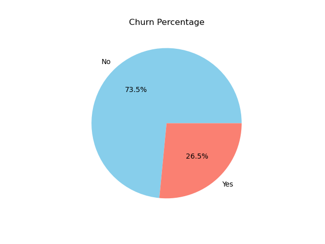
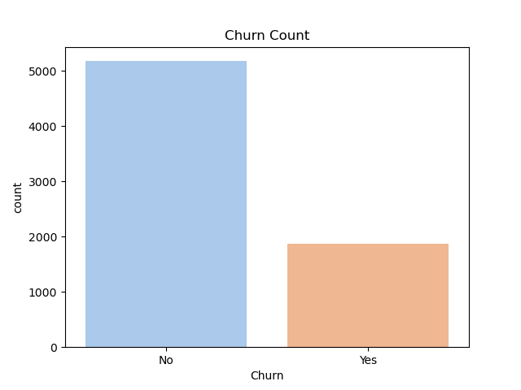
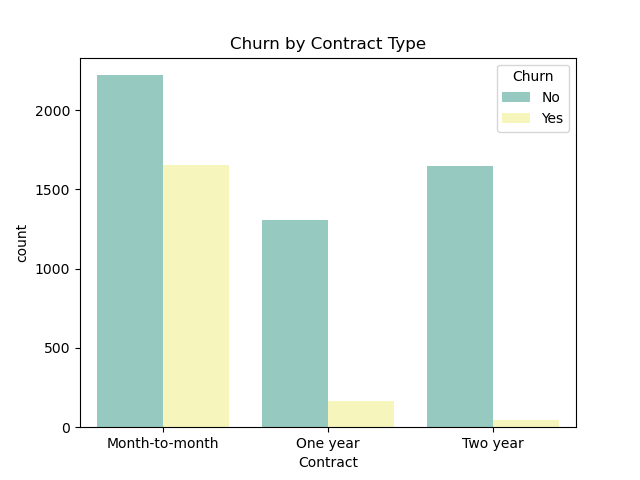
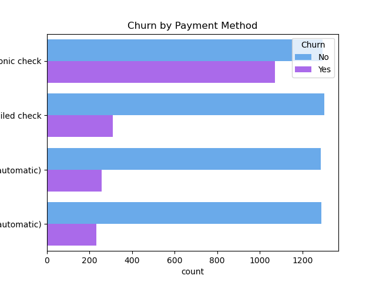
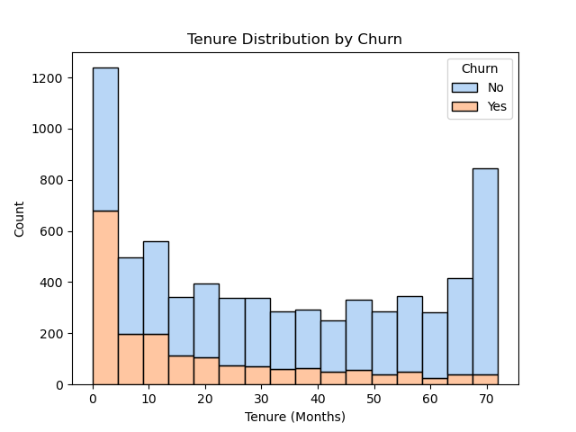

# Telco Customer Churn — EDA & Predictive Modeling

**Question:** Which customer characteristics are associated with leaving a telecom service, and can a classification model identify at-risk customers?

This project combines exploratory analysis and a **Random Forest** classification workflow using the publicly available Telco Customer Churn dataset. It includes data cleaning, visual analysis, preprocessing, class-imbalance handling, and hyperparameter search.

## Business questions

- How does churn vary by contract type, payment method, and tenure?
- Are monthly charges associated with churn?
- Can a classification model help prioritize customer-retention analysis?

## Dataset and project files

- **Dataset:** [Telco Customer Churn CSV](data/WA_Fn-UseC_-Telco-Customer-Churn.csv)
- **Analysis and model:** [Jupyter notebook](notebook/Telco-Customer-Churn.ipynb)
- **Charts:** [outputs folder](outputs/)
- **Original documentation:** [README directory](README.md/README.md)

The dataset contains 7,043 customer records and 21 columns, including tenure, contract, monthly charges, services, payment method, and churn.

## Approach

1. Inspect missing values and convert `TotalCharges` to numeric values, imputing missing values with the median.
2. Split features and the `Churn` target into training and test sets.
3. Standardize numeric variables and one-hot encode categorical variables with a `ColumnTransformer`.
4. Use a pipeline with **SMOTE** on training data and a **RandomForestClassifier**.
5. Evaluate with accuracy, confusion matrix, and classification report, then tune hyperparameters using `GridSearchCV` with F1 scoring.
6. Compare visual patterns across customer segments.

## Visual findings

The exploratory work highlights higher churn among month-to-month subscribers and associations between churn, monthly charges, tenure and payment choices. These are *associations*, not evidence of causation.

| Churn overview | Contract type |
| --- | --- |
|  |  |

| Payment method | Tenure |
| --- | --- |
|  |  |

**Use case:** These exploratory patterns can guide customer-retention questions. Model quality needs to be judged using the notebook's evaluation output, not assumptions from charts.

## Tools

Python · Pandas · NumPy · Matplotlib · Seaborn · scikit-learn · imbalanced-learn · Jupyter

## Reproduce the analysis

Install the listed libraries, open the notebook in Jupyter, and run it with the repository as your working folder. The notebook reads data from `../data/WA_Fn-UseC_-Telco-Customer-Churn.csv`, relative to its `notebook/` directory. Some versions of notebooks may need dependency adjustments.

## Limitations

- The analysis uses one historical dataset and should not be assumed to generalize to current telecom customers.
- Churn predictors can reveal patterns without proving causation.
- Any accuracy or F1 score should be reported from the actual run; this document deliberately does not invent a benchmark.

---

**Author:** Aqsa Mansoor · [GitHub profile](https://github.com/AqsaMansoor32)

> Note: The existing repository uses a directory named `README.md`, which prevents creating a root `README.md` through the normal file API. This overview is proposed separately to preserve the existing documentation until the structure is migrated safely.
